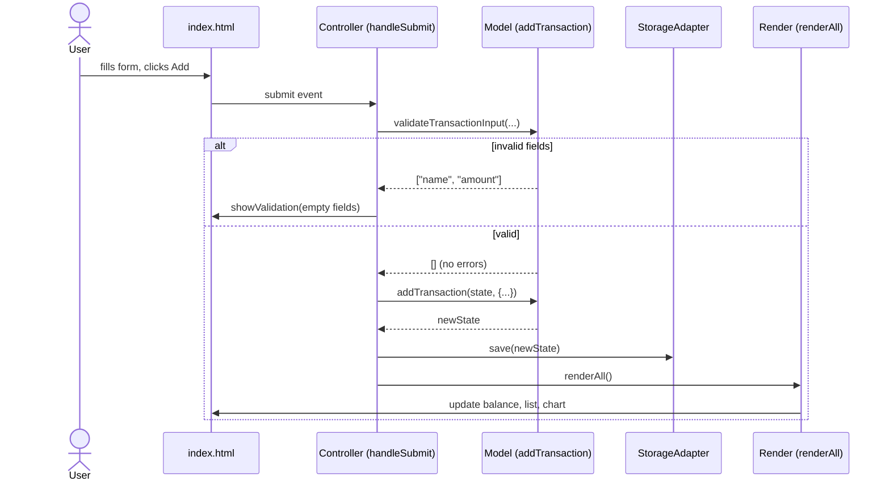

# Design Document

## Overview

This document describes the architecture, components, interfaces, data models, and error-handling strategy for the Expense & Budget Visualizer. The application is a single-page web app built with plain HTML, CSS, and Vanilla JavaScript. It records daily spending transactions, displays a running total, renders a category pie chart via Chart.js, and persists all state to LocalStorage. The design favors a small set of pure, testable functions that operate on an in-memory data model, with thin DOM-rendering glue that reads from and writes to that model.

## Architecture

The application follows a one-way data-flow pattern:

1. **DOM events** (form submit, delete click, sort change, theme toggle) call into **controller functions**.
2. Controller functions mutate the in-memory **State** object via pure **model functions**.
3. After each mutation, a **render** pass re-derives the DOM and chart from State.
4. A **storage adapter** serializes State to LocalStorage on every mutation and deserializes it on load.

```
+-------------------------------------------------------------+
|                        index.html                           |
|   (single-column layout: balance, form, list, chart)        |
+-------------------------------------------------------------+
        |                       |                      |
        v                       v                      v
  css/styles.css          js/app.js (entry)       Chart.js (CDN)
        |                       |
        |                       +--> State (in-memory model)
        |                       +--> Model functions (pure)
        |                       +--> Render functions (DOM/chart)
        |                       +--> Storage adapter
        v
   LocalStorage (persisted state)
```

### Data-flow sequence

The following sequence diagram illustrates the one-way data flow when the user submits a new transaction. Every mutation follows the same pattern: a DOM event calls a controller, the controller calls a pure model function that returns a new State, the storage adapter persists it, and the render layer re-derives the DOM and chart from the updated State.



### Layering

| Layer | Responsibility | Purity |
|-------|---------------|--------|
| Model | Pure data transformations on the State object (add, delete, aggregate, sort, filter) | Pure |
| Storage adapter | Serialize/deserialize State to/from LocalStorage; in-memory fallback | Side-effectful but isolated |
| Controllers | Wire DOM events to model functions, then trigger render | Glue |
| Render | Project State onto the DOM and the Chart.js instance | Side-effectful, deterministic from State |
| View/DOM | Static HTML structure and CSS theming | Declarative |

Keeping the model layer pure lets property-based tests exercise the core logic without a DOM. The render layer is kept deterministic: given the same State it always produces the same output, so render correctness is verified by comparing derived values rather than pixel output.

## Components and Interfaces

### State (data model)

A single in-memory object holding all application data. It is the single source of truth between mutations.

```javascript
// js/app.js

/** @typedef {Object} Transaction
 * @property {string} id        - unique id (crypto.randomUUID or counter fallback)
 * @property {string} name      - item name
 * @property {number} amount    - non-negative monetary amount
 * @property {string} category   - category name
 * @property {string} month      - "YYYY-MM" derived from createdAt
 * @property {number} createdAt  - epoch ms at creation
 */

/** @typedef {Object} AppState
 * @property {Transaction[]} transactions
 * @property {string[]}      customCategories
 * @property {number|null}   spendingLimit  - null or 0 means "no limit"
 * @property {"light"|"dark"} theme
 */

const DEFAULT_CATEGORIES = ["Food", "Transport", "Fun"];

function createInitialState() {
  return {
    transactions: [],
    customCategories: [],
    spendingLimit: null,
    theme: "light",
  };
}

// Transient UI state — not persisted to LocalStorage.
let state = createInitialState();
let currentSort = "none"; // "none" | "amount" | "category"
let chart = null; // Chart.js instance (recreated from State on render)
```

### Model functions (pure)

All domain logic lives as pure functions that take State (and arguments) and return a new State or a derived value. They never touch the DOM or LocalStorage.

```javascript
// --- Transaction operations ---

/** Returns a new State with a transaction appended. Throws on invalid input. */
function addTransaction(state, { name, amount, category, now = Date.now() }) {
  validateTransactionInput({ name, amount, category });
  const tx = {
    id: generateId(),
    name: name.trim(),
    amount: Number(amount),
    category,
    month: toMonthKey(now),
    createdAt: now,
  };
  return { ...state, transactions: [...state.transactions, tx] };
}

/** Returns a new State with the named transaction removed. Idempotent. */
function deleteTransaction(state, id) {
  return { ...state, transactions: state.transactions.filter((t) => t.id !== id) };
}

/** Returns the set of field names that are empty/invalid, or empty set if valid. */
function validateTransactionInput({ name, amount, category }) {
  const empty = [];
  if (!name || !name.trim()) empty.push("name");
  if (amount === "" || amount === null || amount === undefined || isNaN(Number(amount)))
    empty.push("amount");
  if (!category || !category.trim()) empty.push("category");
  return empty;
}

// --- Derived values ---

/** Sum of all transaction amounts. */
function totalBalance(state) {
  return state.transactions.reduce((sum, t) => sum + t.amount, 0);
}

/** Map of category -> sum of amounts. */
function categoryTotals(state) {
  const totals = {};
  for (const t of state.transactions) {
    totals[t.category] = (totals[t.category] || 0) + t.amount;
  }
  return totals;
}

/** Total and per-category totals restricted to a given "YYYY-MM" month. */
function monthlySummary(state, month) {
  const inMonth = state.transactions.filter((t) => t.month === month);
  const total = inMonth.reduce((sum, t) => sum + t.amount, 0);
  const byCategory = {};
  for (const t of inMonth) {
    byCategory[t.category] = (byCategory[t.category] || 0) + t.amount;
  }
  return { total, byCategory };
}

// --- Sorting ---

/** Returns a new array of transactions sorted by amount ascending. */
function sortByAmount(transactions) {
  return [...transactions].sort((a, b) => a.amount - b.amount);
}

/** Returns a new array of transactions sorted by category name alphabetically. */
function sortByCategory(transactions) {
  return [...transactions].sort((a, b) => a.category.localeCompare(b.category));
}

// --- Categories ---

/** Returns default + custom categories. */
function allCategories(state) {
  return [...DEFAULT_CATEGORIES, ...state.customCategories];
}

/** Returns a new State with a custom category added (de-duplicated). */
function addCustomCategory(state, name) {
  const trimmed = name.trim();
  if (!trimmed) return state;
  if (allCategories(state).includes(trimmed)) return state;
  return { ...state, customCategories: [...state.customCategories, trimmed] };
}

// --- Spending limit ---

/** True when the highlight should be applied. */
function isOverLimit(state) {
  return state.spendingLimit > 0 && totalBalance(state) > state.spendingLimit;
}

// --- Helpers ---

function toMonthKey(epochMs) {
  const d = new Date(epochMs);
  const yyyy = d.getFullYear();
  const mm = String(d.getMonth() + 1).padStart(2, "0");
  return `${yyyy}-${mm}`;
}

function generateId() {
  if (typeof crypto !== "undefined" && crypto.randomUUID) return crypto.randomUUID();
  return "id-" + Date.now() + "-" + Math.random().toString(36).slice(2);
}
```

### Storage adapter

A single adapter object isolates all LocalStorage access and provides an in-memory fallback when LocalStorage is unavailable. Only JSON-serializable primitives are stored.

```javascript
const STORAGE_KEY = "expenseBudgetVisualizer";

const StorageAdapter = {
  _memoryFallback: {},
  _useMemory: false,

  _available() {
    try {
      const k = "__ebv_test__";
      localStorage.setItem(k, "1");
      localStorage.removeItem(k);
      return true;
    } catch {
      return false;
    }
  },

  load() {
    if (!this._available()) {
      this._useMemory = true;
      return createInitialState();
    }
    try {
      const raw = localStorage.getItem(STORAGE_KEY);
      if (!raw) return createInitialState();
      const parsed = JSON.parse(raw);
      return normalizeState(parsed);
    } catch {
      return createInitialState();
    }
  },

  save(state) {
    const data = serializeState(state);
    if (this._useMemory) {
      this._memoryFallback[STORAGE_KEY] = JSON.stringify(data);
      return;
    }
    try {
      localStorage.setItem(STORAGE_KEY, JSON.stringify(data));
    } catch {
      this._useMemory = true;
      this._memoryFallback[STORAGE_KEY] = JSON.stringify(data);
    }
  },
};
```

`serializeState` strips transient fields (e.g., the Chart.js instance is never in State) and `normalizeState` coerces a parsed object back into a valid `AppState`, defaulting missing fields.

```javascript
/** Returns a plain serializable AppState snapshot (no transient fields). */
function serializeState(state) {
  return {
    transactions: state.transactions.map((t) => ({
      id: t.id,
      name: t.name,
      amount: t.amount,
      category: t.category,
      month: t.month,
      createdAt: t.createdAt,
    })),
    customCategories: [...state.customCategories],
    spendingLimit: typeof state.spendingLimit === "number" ? state.spendingLimit : null,
    theme: state.theme === "dark" ? "dark" : "light",
  };
}

/** Coerces an arbitrary parsed object into a valid AppState, dropping malformed entries. */
function normalizeState(parsed) {
  const rawTxs = Array.isArray(parsed?.transactions) ? parsed.transactions : [];
  const transactions = rawTxs
    .filter(
      (t) =>
        t &&
        typeof t.id === "string" &&
        typeof t.name === "string" &&
        typeof t.amount === "number" &&
        !isNaN(t.amount) &&
        t.amount >= 0 &&
        typeof t.category === "string" &&
        typeof t.month === "string" &&
        typeof t.createdAt === "number"
    )
    .map((t) => ({ ...t }));
  const customCategories = Array.isArray(parsed?.customCategories)
    ? parsed.customCategories.filter((c) => typeof c === "string" && c.trim())
    : [];
  const spendingLimit =
    typeof parsed?.spendingLimit === "number" && parsed.spendingLimit > 0
      ? parsed.spendingLimit
      : null;
  const theme = parsed?.theme === "dark" ? "dark" : "light";
  return { transactions, customCategories, spendingLimit, theme };
}
```

### Controllers (event glue)

Controllers read form values, call a model function, save, and re-render.

```javascript
function handleSubmit(event) {
  event.preventDefault();
  const name = nameInput.value;
  const amount = amountInput.value;
  const category = categorySelect.value;
  const empty = validateTransactionInput({ name, amount, category });
  if (empty.length > 0) {
    showValidation(empty);
    return;
  }
  clearValidation();
  state = addTransaction(state, { name, amount, category });
  StorageAdapter.save(state);
  renderAll();
}

function handleDelete(id) {
  state = deleteTransaction(state, id);
  StorageAdapter.save(state);
  renderAll();
}

function handleSort(value) {
  currentSort = value; // "amount" | "category" | "none"
  renderTransactionList();
}

function handleAddCategory() {
  const name = newCategoryInput.value;
  state = addCustomCategory(state, name);
  StorageAdapter.save(state);
  newCategoryInput.value = "";
  renderCategoryOptions();
  renderAll();
}

function handleSetLimit(value) {
  const num = Number(value);
  state = { ...state, spendingLimit: num > 0 ? num : null };
  StorageAdapter.save(state);
  renderBalance();
}

function handleThemeToggle() {
  state = { ...state, theme: state.theme === "light" ? "dark" : "light" };
  StorageAdapter.save(state);
  applyTheme(state.theme);
}

function handleMonthSelect(value) {
  // value is "YYYY-MM" from the <input type="month"> control
  const summary = monthlySummary(state, value);
  renderMonthlySummary(value, summary);
}
```

### Render functions

Render functions are deterministic projections of State onto the DOM and chart.

```javascript
function renderAll() {
  renderBalance();
  renderTransactionList();
  renderCategoryOptions();
  renderChart();
  // Keep the monthly summary in sync if a month is currently selected
  if (monthSelectEl.value) {
    renderMonthlySummary(monthSelectEl.value, monthlySummary(state, monthSelectEl.value));
  }
}

function renderBalance() {
  const total = totalBalance(state);
  balanceEl.textContent = formatCurrency(total);
  balanceEl.classList.toggle("over-limit", isOverLimit(state));
}

function renderTransactionList() {
  let list = state.transactions;
  if (currentSort === "amount") list = sortByAmount(list);
  else if (currentSort === "category") list = sortByCategory(list);
  listEl.innerHTML = "";
  for (const t of list) {
    listEl.appendChild(createTransactionRow(t));
  }
}

function renderChart() {
  const totals = categoryTotals(state);
  const labels = Object.keys(totals);
  const data = labels.map((l) => totals[l]);
  // update existing Chart.js instance or create it
  if (chart) {
    chart.data.labels = labels;
    chart.data.datasets[0].data = data;
    chart.update();
  }
}

/** Renders the monthly summary for the selected month (Req 6.2, 6.3). */
function renderMonthlySummary(month, summary) {
  monthlyTotalEl.textContent = formatCurrency(summary.total);
  monthlyBreakdownEl.innerHTML = "";
  for (const [cat, amt] of Object.entries(summary.byCategory)) {
    const li = document.createElement("li");
    li.textContent = `${cat}: ${formatCurrency(amt)}`;
    monthlyBreakdownEl.appendChild(li);
  }
}

/** Builds a single transaction list row with delete control. */
function createTransactionRow(t) {
  const li = document.createElement("li");
  li.dataset.id = t.id;
  li.innerHTML =
    `<span class="tx-name">${escapeHtml(t.name)}</span>` +
    `<span class="tx-amount">${formatCurrency(t.amount)}</span>` +
    `<span class="tx-category">${escapeHtml(t.category)}</span>` +
    `<button class="delete-btn" data-action="delete" data-id="${t.id}">Delete</button>`;
  return li;
}

/** Shows a validation message naming the empty fields (Req 1.3). */
function showValidation(emptyFields) {
  const names = { name: "Item Name", amount: "Amount", category: "Category" };
  validationMessageEl.textContent =
    "Please fill in: " + emptyFields.map((f) => names[f]).join(", ");
  validationMessageEl.hidden = false;
}

function clearValidation() {
  validationMessageEl.hidden = true;
  validationMessageEl.textContent = "";
}

/** Formats a number as a currency string. */
function formatCurrency(amount) {
  return "$" + Number(amount).toFixed(2);
}

/** Escapes user-supplied text for safe insertion into innerHTML. */
function escapeHtml(str) {
  const div = document.createElement("div");
  div.textContent = str;
  return div.innerHTML;
}
```

### Theme application

```javascript
function applyTheme(theme) {
  document.body.dataset.theme = theme;
}
```

### Public DOM interface (index.html structure)

```html
<!DOCTYPE html>
<html lang="en">
<head>
  <meta charset="UTF-8" />
  <meta name="viewport" content="width=device-width, initial-scale=1.0" />
  <link rel="stylesheet" href="css/styles.css" />
  <title>Expense & Budget Visualizer</title>
</head>
<body data-theme="light">
  <main class="app">
    <!-- 1. Total Balance -->
    <section id="balance-section">
      <h2>Total Balance</h2>
      <div id="balance" class="balance"></div>
      <div id="limit-controls">
        <input id="limit-input" type="number" min="0" placeholder="Spending limit" />
      </div>
    </section>

    <!-- 2. Input form -->
    <section id="form-section">
      <form id="entry-form">
        <input id="name-input" type="text" placeholder="Item name" required />
        <input id="amount-input" type="number" min="0" step="0.01" placeholder="Amount" required />
        <select id="category-select"></select>
        <button type="submit">Add</button>
      </form>
      <div id="new-category-row">
        <input id="new-category-input" type="text" placeholder="New category" />
        <button id="add-category-btn" type="button">Add Category</button>
      </div>
      <p id="validation-message" class="validation-message" hidden></p>
    </section>

    <!-- 3. Transaction list -->
    <section id="list-section">
      <div id="sort-controls">
        <select id="sort-select">
          <option value="none">Sort: None</option>
          <option value="amount">Sort by Amount</option>
          <option value="category">Sort by Category</option>
        </select>
      </div>
      <ul id="transaction-list" class="transaction-list"></ul>
    </section>

    <!-- 4. Pie chart -->
    <section id="chart-section">
      <h2>Spending by Category</h2>
      <canvas id="pie-chart"></canvas>
    </section>

    <!-- 5. Monthly summary -->
    <section id="summary-section">
      <h2>Monthly Summary</h2>
      <input id="month-select" type="month" />
      <div id="monthly-total"></div>
      <ul id="monthly-breakdown"></ul>
    </section>

    <!-- 6. Theme toggle -->
    <button id="theme-toggle" type="button">Toggle Theme</button>
  </main>

  <!-- Chart.js from CDN -->
  <script src="https://cdn.jsdelivr.net/npm/chart.js"></script>
  <!-- All remaining logic in a single file -->
  <script src="js/app.js"></script>
</body>
</html>
```

The single-column vertical stacking order is: Total Balance, input form, transaction list, pie chart. The monthly summary and theme toggle are additional controls appended after the chart, also stacked vertically.

### Model function contracts

| Function | Input | Output | Purity |
|----------|-------|--------|--------|
| `addTransaction(state, {name, amount, category, now?})` | valid input | new State with one more tx | Pure (except id gen) |
| `deleteTransaction(state, id)` | id | new State without tx | Pure |
| `validateTransactionInput({name, amount, category})` | form values | string[] of empty fields | Pure |
| `totalBalance(state)` | State | number | Pure |
| `categoryTotals(state)` | State | {category: number} | Pure |
| `monthlySummary(state, month)` | State, "YYYY-MM" | {total, byCategory} | Pure |
| `sortByAmount(transactions)` | Transaction[] | sorted copy | Pure |
| `sortByCategory(transactions)` | Transaction[] | sorted copy | Pure |
| `allCategories(state)` | State | string[] (defaults + custom) | Pure |
| `addCustomCategory(state, name)` | State, name | new State | Pure |
| `isOverLimit(state)` | State | boolean | Pure |
| `toMonthKey(epochMs)` | number | "YYYY-MM" | Pure |
| `generateId()` | none | string | Pure (except entropy) |
| `serializeState(state)` | State | serializable snapshot | Pure |
| `normalizeState(parsed)` | parsed object | AppState | Pure |
| `StorageAdapter.load()` | none | AppState | Side-effect |
| `StorageAdapter.save(state)` | State | void | Side-effect |

## Data Models

### Transaction

```javascript
{
  id: string,          // unique, used for delete
  name: string,        // trimmed item name
  amount: number,      // non-negative number
  category: string,    // one of default or custom categories
  month: string,       // "YYYY-MM" derived from createdAt
  createdAt: number    // epoch ms
}
```

### AppState (persisted shape)

```javascript
{
  transactions: Transaction[],
  customCategories: string[],
  spendingLimit: number | null,   // null or 0 = no limit
  theme: "light" | "dark"
}
```

### LocalStorage schema

A single key `expenseBudgetVisualizer` holds a JSON string of the persisted AppState. The Chart.js instance, DOM references, and the current sort selection are transient and not persisted.

## Error Handling

### Input validation (Req 1.3)

`validateTransactionInput` returns the list of empty/invalid field names. The controller displays a message naming exactly those fields and does not create a transaction. Amounts that are empty, `NaN`, or negative are treated as invalid. Whitespace-only names are treated as empty.

### LocalStorage unavailability (Req 10.3)

The storage adapter probes LocalStorage on first use. If `setItem`/`getItem` throw (private mode, quota, or disabled), the adapter sets `_useMemory = true` and stores serialized state in an in-memory object for the session. All controllers continue to call `StorageAdapter.save` without branching, so the rest of the app is unaffected. On load, if LocalStorage is unavailable, `load()` returns a fresh `createInitialState()`.

### Corrupt or partial persisted state

`normalizeState(parsed)` coerces an arbitrary parsed object into a valid `AppState`: missing arrays default to `[]`, missing `spendingLimit` defaults to `null`, unknown `theme` values default to `"light"`, and any transaction missing required fields is dropped. If JSON parsing fails entirely, `load()` returns `createInitialState()`.

### Amount parsing

Amounts from the input field are strings. The model coerces with `Number(amount)`. A value of `""` or a non-numeric string is caught by validation before coercion. Negative amounts are rejected by validation (the input has `min="0"` and validation checks the parsed number).

### Chart.js load failure

If the Chart.js script fails to load (offline/blocked CDN), `renderChart` guards on the existence of the global `Chart` constructor and the canvas context. When unavailable, the chart section shows a fallback message and the rest of the app (list, balance, summary) continues to function from the same State.

## Theme Strategy

Themes are applied via a `data-theme` attribute on `<body>`. CSS uses `[data-theme="light"]` and `[data-theme="dark"]` selectors with CSS variables for colors. This keeps theme application a single attribute change (`applyTheme`) rather than class toggling across many elements, satisfying the "entire interface" requirement (Req 9.2) deterministically.

## Responsive Layout Strategy

The layout uses a single `.app` column with `max-width` and `width: 100%`. At viewport widths of 768px or below, all sections stack vertically with no horizontal scroll. Flexbox/grid is avoided in favor of simple block stacking to guarantee the single-column order (Req 11.1, 11.2). All custom styles live in `css/styles.css`; all logic lives in `js/app.js` (Req 11.3, 11.4).

## Correctness Properties


*A property is a characteristic or behavior that should hold true across all valid executions of a system—essentially, a formal statement about what the system should do. Properties serve as the bridge between human-readable specifications and machine-verifiable correctness guarantees.*

The properties below target the pure model layer so they can be tested with property-based testing (100+ randomized iterations). UI-presence criteria (1.1, 1.4, 2.2, 6.2, 7.1, 9.1, 11.1, 11.2) are covered by example-based unit tests, infrastructure/setup checks (4.1, 11.3, 11.4, 12.2) by smoke tests, and cross-browser behavior (12.1) by manual integration tests, as noted in the testing strategy.

### Property 1: Transaction creation preserves input

*For any* valid (non-empty) item name, non-negative amount, and category, submitting the input form creates a transaction whose stored name, amount, and category equal the submitted values.

**Validates: Requirements 1.2**

### Property 2: Empty-field validation rejects submissions

*For any* combination of empty (or whitespace-only) fields among name, amount, and category, submitting the form produces a validation message naming exactly the empty fields and creates no transaction, leaving the transaction list unchanged.

**Validates: Requirements 1.3**

### Property 3: Transaction list renders all entries

*For any* set of stored transactions, the rendered transaction list contains exactly one entry per transaction, and each entry displays that transaction's name, amount, and category.

**Validates: Requirements 2.1**

### Property 4: Delete removes the transaction and is idempotent

*For any* state and any transaction id, deleting that id removes the matching transaction from storage and the displayed list; deleting the same id a second time produces the same state as deleting it once.

**Validates: Requirements 2.3**

### Property 5: Total balance equals the sum of amounts after any state transition

*For any* state, the displayed Total Balance equals the sum of all transaction amounts; this holds after adding a transaction, after deleting a transaction, and for the initial empty state (sum = 0).

**Validates: Requirements 3.1, 3.2**

### Property 6: Category aggregation matches a direct sum after any state transition

*For any* set of transactions, the pie-chart category data maps each category to the exact sum of that category's transaction amounts; this holds after adding a transaction, after deleting a transaction, and for the initial empty state.

**Validates: Requirements 4.2, 4.3**

### Property 7: Custom category persists and participates fully

*For any* valid custom category name added by the user, the category persists across a save/load round-trip, appears in the category field options alongside the defaults, and, when transactions use it, appears as its own slice in the pie-chart data.

**Validates: Requirements 5.1, 5.2**

### Property 8: Transactions carry the correct creation month

*For any* transaction created at a given instant, the transaction's month tag equals the "YYYY-MM" key derived from that instant, so it is grouped with other transactions from the same calendar month.

**Validates: Requirements 6.1**

### Property 9: Monthly summary totals match month-filtered sums

*For any* set of transactions spanning arbitrary months and any selected month, the Monthly Summary total equals the sum of amounts of transactions whose month tag matches the selection, and each per-category total equals the sum of that category's amounts within the selected month.

**Validates: Requirements 6.3**

### Property 10: Sort by amount produces a non-decreasing order

*For any* list of transactions, sorting by amount yields a list where each transaction's amount is less than or equal to the next transaction's amount, and the sorted list is a permutation of the original.

**Validates: Requirements 7.2**

### Property 11: Sort by category produces alphabetical order

*For any* list of transactions, sorting by category yields a list where each transaction's category name precedes or equals the next in lexicographic order, and the sorted list is a permutation of the original.

**Validates: Requirements 7.3**

### Property 12: Spending limit highlight reflects the total-vs-limit relationship

*For any* spending limit value and any set of transactions, the Total Balance is visually highlighted if and only if the limit is greater than zero and the Total Balance exceeds the limit; when the limit is empty, zero, or non-positive, no highlight is applied.

**Validates: Requirements 8.1, 8.2, 8.3**

### Property 13: Theme toggle switches and double-toggle restores the original

*For any* starting theme, toggling once switches to the opposite theme and applies it to the entire interface, and toggling a second time restores the original theme.

**Validates: Requirements 9.2**

### Property 14: Full application state round-trips through LocalStorage

*For any* valid application state (transactions, custom categories, spending limit, and theme), serializing the state to LocalStorage and then loading it back produces an equivalent state where every transaction, custom category, the spending limit, and the theme are preserved.

**Validates: Requirements 10.1, 10.2, 9.3**

## Testing Strategy

### Property-based tests (model layer)

The 14 correctness properties above are verified with a property-based test runner (e.g., `fast-check` loaded via CDN in a test HTML page, or Node with `fast-check` since the model layer is pure JavaScript with no DOM). Each property test runs a minimum of 100 randomized iterations. Generators produce random transactions (names, amounts, categories from default + custom pools), random custom category names, random spending limits, and random month selections. Each test is tagged:

**Feature: expense-budget-visualizer, Property {number}: {property_text}**

### Edge cases covered by generators

- Property 2: all subsets of empty/whitespace-only fields.
- Property 5 & 6: empty transaction set (sum = 0).
- Property 9: months with zero transactions.
- Property 12: zero, negative, and null spending limits.
- Property 14: empty state and large transaction sets.

### Edge case requiring its own test (Req 10.3)

LocalStorage unavailability is verified with an example/edge test that mocks `localStorage` to throw on access, confirms the app falls back to in-memory storage, and verifies add/delete/total still work within the session.

### Example-based unit tests

- 1.1: form contains Item Name, Amount, and Category fields.
- 1.4: category options initialized to Food, Transport, Fun.
- 2.2: many transactions produce a scrollable list container.
- 6.2: monthly summary view contains a month selector.
- 7.1: sort control offers Amount and Category options.
- 9.1: theme toggle control exists.
- 11.1: sections appear in the required vertical DOM order.
- 11.2: at 768px viewport, layout is single-column without horizontal scroll.

### Smoke tests

- 4.1: Chart.js loaded from CDN and a chart instance is created.
- 11.3: `css/` contains exactly one CSS file and `js/` exactly one JS file.
- 11.4: Chart.js loaded via CDN script tag; remaining logic in the single JS file.
- 12.2: the JS file contains no framework imports (React, Vue, Angular, etc.).

### Integration (manual) test

- 12.1: verify core flows (add, delete, total, chart, summary, theme) in Chrome, Firefox, Edge, and Safari.
